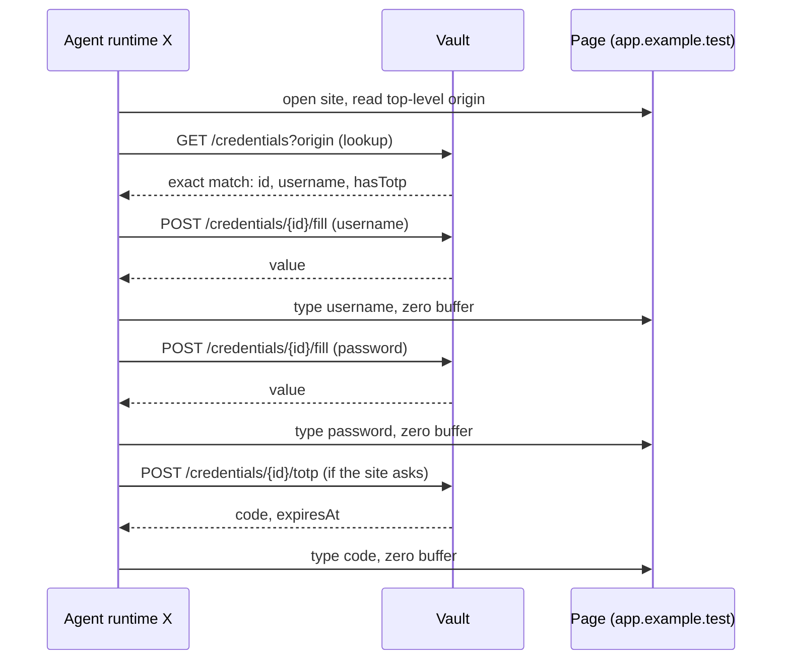

# Agent credential API: guide for agent-runtime authors

For people building an agent runtime (a browser-automation fabric, a desktop agent) that logs in to websites with a Vault user's logins. The runtime finds the login for the site on screen, asks for **one field at a time**, types it itself, and never shows it to a model. Reasoning: [ADR-0002](decisions/0002-agent-access.md). Operator setup: [runbook](runbooks/agent-access.md). Threat model: [SECURITY-ARCHITECTURE.md §16](SECURITY-ARCHITECTURE.md#16-oauth-server-agent-access).

All examples use invented values: `https://vault.example.test` is the Vault, `https://app.example.test` a website, "Agent runtime X" the runtime.

Do not use MCP (`/api/mcp`) for secret values: it never returns one, by design. This API is the one for runtimes.

## Contract package

`@marinoscar/vault-contract/agent` exports the Zod schemas and types of every request and response below (`agentLookupQuerySchema`, `agentFillRequestSchema`, `agentFillResponseSchema`, `agentTotpRequestSchema`, `agentCreateCredentialRequestSchema`, `agentRotatePasswordRequestSchema`, `agentWhoamiResponseSchema`, ...), `AGENT_SCOPES`, `AGENT_ERROR_CODES`, `agentPurposeSchema` and `AGENT_API_BASE_PATH`. Its stability is **experimental** (`@stability experimental`): shapes may change before 1.0. The version is in the path; an incompatible change is `/api/agent/v2`.

## 1. Get a token (OAuth)

Vault is an OAuth 2.1 authorization server. The user must have an administrator register your runtime as a client first ([runbook](runbooks/agent-access.md#register-an-agent-runtime-administrator)).

| Item | Value |
|---|---|
| Flow | Authorization code with PKCE (`S256`), run by your server for a confidential client |
| Endpoints | `GET /api/oauth/authorize`, `POST /api/oauth/token`, `POST /api/oauth/revoke`; discovery at `GET /api/oauth/.well-known/authorization-server` and the protected-resource metadata under `/api/oauth/.well-known/protected-resource` |
| Resource indicator | `resource=https://vault.example.test/api/agent/v1` (the Vault's `APP_URL` plus `/api/agent/v1`) on both the authorize and token requests |
| Scopes | `vault:items_read` (lookup, `whoami`; default), `vault:items_fill` (fill, one-time code), `vault:items_write` (create, rotate), plus `offline_access` for a refresh token. Ask only for what you use |
| Tokens | `oat_` access token (short-lived), `ort_` refresh token (rotates on use). Send `Authorization: Bearer oat_...` |
| Consent | The user sees your client name and the scopes on `/oauth/consent` before a code is issued |

A scope **narrows** the user's own permissions; it never adds. A token for the `agent` resource works **only** under `/api/agent/v1`: `/api/secrets/*` and every other route refuse it. A route that needs a scope your token lacks answers `403` with `WWW-Authenticate: Bearer error="insufficient_scope"`; start a new consent asking for it. A revoked grant, an expired token or a replayed refresh token answers `401`; reconnect.

Refresh tokens rotate: store the new one on every refresh and discard the old. Replaying a used refresh token revokes the whole grant. A personal access token (`pat_`) also works on this API but carries the user's full authority and has no consent or per-app revocation; use OAuth.

## 2. Rules for every route

- Base path `/api/agent/v1`. Responses are `{ "data": ... }`; errors are `{ code?, message }`.
- **Kill switch:** while the deployment's `agentAccess.enabled` is off (the default), every route including `whoami` answers `403 AGENT_ACCESS_DISABLED`.
- **Credential kind:** `oat_` or `pat_`. A browser session answers `403 AGENT_CREDENTIAL_REQUIRED` (except `whoami`).
- **Opt-in:** you only ever reach `Credential` logins their owner opened to agents. A login that does not exist, belongs to someone else, is not a `Credential` or is not opened is **one identical `404`**. You cannot tell which.
- **Origin binding:** fill, code and rotate need `origin` to equal one of the login's origins exactly.
- **Caching:** every response, errors included, carries `Cache-Control: no-store` and `Pragma: no-cache`. Do not cache it, and do not log bodies.
- **Audit:** every call, allowed or refused, is recorded for the owner with your client, the login, the origin, the field and the `purpose`. Never the value. The owner sees it and is notified of new apps, creations and rotations.

### Origins

`origin` is a URL or bare host; Vault normalizes it to `scheme://host[:port]`:

| Rule | Detail |
|---|---|
| Bare host | `app.example.test` means `https://app.example.test` |
| Case, path, query, userinfo | Host lower-cased (IDN as punycode); path, query, fragment and userinfo dropped |
| Default port | Dropped (`:443` on https) |
| Scheme | `https` only, plus `http` for `localhost`, `127.0.0.1`, `[::1]` |
| Invalid | `400` |
| **Exact** match | Normalized origins are equal. Required to fill, get a code or rotate; otherwise `403 ORIGIN_MISMATCH` |
| **Site** match | Same registrable domain (for example `login.example.test` vs `app.example.test`). Lookup returns it as `matchKind: "site"` for information. It is **never fillable** |

Send the origin of the page you are actually on, taken from the browser (the top-level document URL), never from model output or page text. This is what stops a prompt-injected agent that was steered to a look-alike site.

### Purpose

`purpose` is required on fill, code, create and rotate and is shown to the owner.

| Value | Use |
|---|---|
| `login` | Signing in |
| `signup` | Creating an account (with `POST /credentials`) |
| `password_change` | Changing a password (with rotate) |
| `mfa` | Entering a one-time code |

### Rate limits

Per OAuth grant (or PAT) and user, per minute, counted before the login is looked up:

| Bucket | Routes | Default |
|---|---|---|
| lookup | `GET /credentials` | 60 |
| fill | `POST /credentials/{id}/fill` | 30 |
| totp | `POST /credentials/{id}/totp` | 10 |
| write | `POST /credentials`, `POST /credentials/{id}/password` (together) | 10 |

Over the limit: `429` with code `RATE_LIMITED` and a `Retry-After` header (seconds). Wait; do not retry in a loop. Administrators can change the limits.

## 3. Routes

### GET /api/agent/v1/whoami

Scope `vault:items_read`. Returns `{ "data": { "userId", "scopes": [...], "clientId" } }`. Use it to check the token works and which scopes you hold.

### GET /api/agent/v1/credentials?origin=

Scope `vault:items_read`. Finds the user's opened logins for a site, exact matches first:

```json
{ "data": [ {
  "id": "7f1c2e9a-0000-4000-8000-000000000001",
  "name": "Shop login", "username": "person-a@example.test",
  "origins": ["https://app.example.test"],
  "matchKind": "exact", "hasTotp": true,
  "updatedAt": "2030-01-02T03:04:05.000Z"
} ] }
```

The username is returned (it is not sensitive); no password, code or seed ever is. Errors: `400` invalid origin, `403` scope or kill switch, `429`.

### POST /api/agent/v1/credentials/{id}/fill

Scope `vault:items_fill`. Body and response:

```json
{ "field": "username", "origin": "https://app.example.test", "purpose": "login" }
```
```json
{ "data": { "value": "..." } }
```

`field` is `username` or `password`. One field per call; there is no call that returns both. Errors: `400`, `403 ORIGIN_MISMATCH`, `403` scope or kill switch, `404` (see Opt-in), `429`.

### POST /api/agent/v1/credentials/{id}/totp

Scope `vault:items_fill`. Body `{ "origin", "purpose": "mfa" }`; response `{ "data": { "code": "123456", "expiresAt": "<ISO 8601>" } }`. The seed is never returned. `404` also when the login has no usable authenticator key (`hasTotp: false`). A code lives for its period (usually 30 seconds): fetch it right before typing it, not earlier.

### POST /api/agent/v1/credentials

Scope `vault:items_write`. Saves a new login, owned by the user, already opened to agents. Send exactly one of `password` and `generate`:

```json
{ "name": "Shop login", "username": "person-a@example.test", "origin": "https://app.example.test",
  "additionalUrls": ["https://shop.example.test"], "purpose": "signup",
  "generate": { "length": 24, "symbols": true } }
```

`generate`: `length` 12 to 128 (default 24), `symbols` default true; the result has a lower-case letter, an upper-case letter and a digit, and a symbol when `symbols` is on. `additionalUrls`: at most 19. Response `201 { "data": { "id", "name", "username", "origins", "generatedPassword"? } }`. `generatedPassword` is present only when you sent `generate`, and **only in this response**; Vault never returns it again except through `fill`. A password you supplied is never echoed. Errors: `400` (both or neither of `password`/`generate`, invalid origin), `409` the user already has a secret with that name, `403`, `429`.

### POST /api/agent/v1/credentials/{id}/password

Scope `vault:items_write`. Rotates the password. Body `{ "origin", "purpose": "password_change", "password" | "generate" }` (exactly one); response `{ "data": { "id", "version", "generatedPassword"? } }`. A new version is added (the owner can roll back; other fields are kept). The origin must match exactly. Order of operations for a password change on a site: rotate in Vault **first**, read the new value from the response (when you generated it), type it into the site's change-password form, and tell the user if the site rejects it so they can roll back.

### Errors

| Status | `code` | Meaning |
|---|---|---|
| 400 | | Invalid body or origin |
| 401 | | Missing, expired or revoked token |
| 403 | `AGENT_ACCESS_DISABLED` | Deployment kill switch off |
| 403 | `ORIGIN_MISMATCH` | Origin is not exactly one of the login's |
| 403 | `AGENT_CREDENTIAL_REQUIRED` | A browser session was used |
| 403 | | Scope missing: `WWW-Authenticate` `insufficient_scope` |
| 404 | | Login not found, not yours, not a Credential, or not opened (identical) |
| 409 | | Name already taken (create) |
| 429 | `RATE_LIMITED` | See `Retry-After` |

Do not branch on `message` text; it is static and may change.

## 4. Holding a value

A returned value is the most sensitive thing your runtime ever touches. Rules:

1. **Memory only.** Keep it in a process-local buffer for the single operation. Never write it to disk, a database, a cache, a queue or a screenshot.
2. **Never into model context.** Not in a prompt, a tool result, a trace shown to a model, a screenshot caption or an error message the model sees. The model asks for "the password for this login"; your fabric fetches and types it. Have the tool answer "typed" or "failed".
3. **Never in logs or telemetry.** Do not log request or response bodies of this API, headers, or spans carrying them. Redact on the way in, not on the way out. Set a canary value in tests and scan your logs, traces and artifacts for it, as Vault does.
4. **Zero after typing.** Overwrite the buffer (a mutable byte array, not an immutable string where you can avoid it) right after the keystrokes are sent, including on failure and cancellation paths.
5. **Type with trusted input into the page you verified.** Check the page's origin immediately before typing and send that same origin to Vault. If the page navigated, start over.
6. **Do not retry blindly.** A `403 ORIGIN_MISMATCH` means stop and tell the user; it is how a look-alike site is caught.
7. **Do not cache lookups** past the page they were for; the owner can close a login at any time.

## 5. Recommended flow



1. Lookup by the page origin. Use only a `matchKind: "exact"` result. If there is none, or several, ask the user; do not guess.
2. Fill `username`, type it. Fill `password`, type it. Each is its own call.
3. If the site asks for a second factor and `hasTotp` is true, request a code and type it at once.
4. A new account: `POST /credentials` with `generate`, take `generatedPassword` from the response, type it into the sign-up form. If the sign-up fails, the login still exists; tell the user.
5. A password change: rotate as described above.

## 6. What the owner sees

Agent activity lists each call with your client name, the login, the origin, the field and the purpose, and the bell reports your first use, a created login and a rotation. The owner can revoke your grant at any time (your next call is `401`) and can close any login with one switch.
