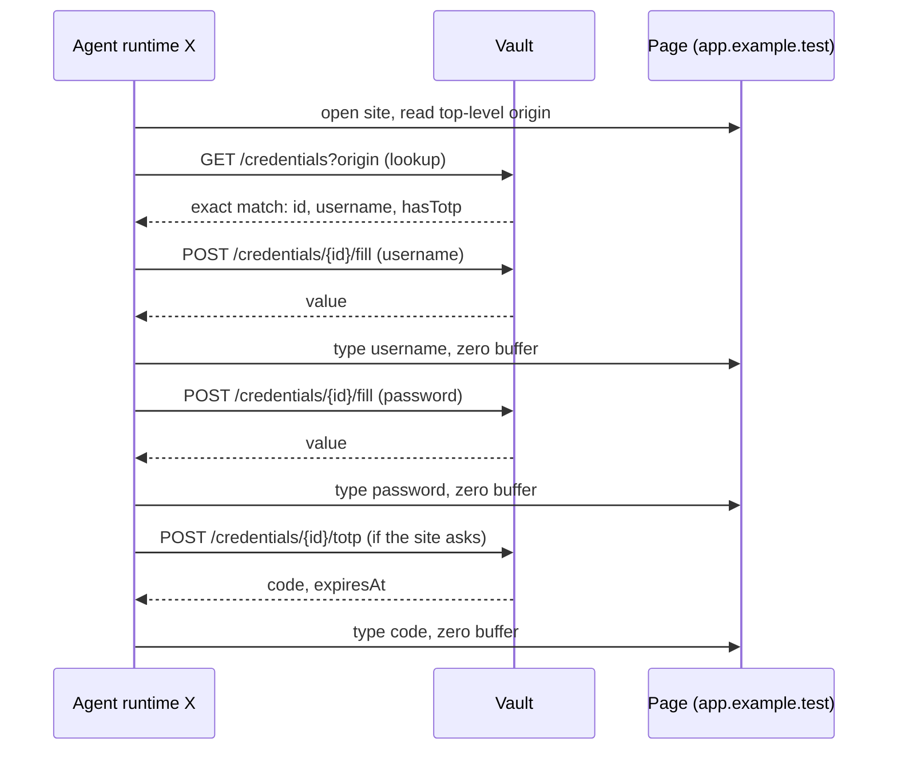

# Agent credential API: guide for agent-runtime authors

For people building an agent runtime (a browser-automation fabric, a desktop agent) that logs in to websites with a Vault user's logins. The runtime finds the login for the site on screen, asks for **one field at a time**, types it itself, and never shows it to a model. Reasoning: [ADR-0002](decisions/0002-agent-access.md); cards and identity: [ADR-0003](decisions/0003-agent-cards-identity.md) and [section 7](#7-cards-and-identity-adr-0003); keys of outside services for your server: [section 11](#11-service-keys). Operator setup: [runbook](runbooks/agent-access.md). Threat model: [SECURITY-ARCHITECTURE.md §16](SECURITY-ARCHITECTURE.md#16-oauth-server-agent-access).

All examples use invented values: `https://vault.example.test` is the Vault, `https://app.example.test` a website, "Agent runtime X" the runtime.

Do not use MCP (`/api/mcp`) for secret values: it never returns one, by design. This API is the one for runtimes.

## Contract package

`@marinoscar/vault-contract/agent` exports the Zod schemas and types of every request and response below (`agentLookupQuerySchema`, `agentFillRequestSchema`, `agentFillResponseSchema`, `agentTotpRequestSchema`, `agentCreateCredentialRequestSchema`, `agentRotatePasswordRequestSchema`, `agentWhoamiResponseSchema`, ...), `AGENT_SCOPES`, `AGENT_ERROR_CODES`, `agentPurposeSchema`, `AGENT_API_BASE_PATH`, `AGENT_CONTRACT_VERSION` and `AGENT_CONTRACT_FEATURES`. Its stability is **beta** (`@stability beta`); the promise is in [section 9](#9-stability) and every change is listed in [section 8](#8-changes). `@marinoscar/vault-contract/agent-testing` is the conformance kit for your runtime's tests ([section 10](#10-conformance-kit)).

## 1. Get a token (OAuth)

Vault is an OAuth 2.1 authorization server. The user must have an administrator register your runtime as a client first ([runbook](runbooks/agent-access.md#register-an-agent-runtime-administrator)).

| Item | Value |
|---|---|
| Flow | Authorization code with PKCE (`S256`), run by your server for a confidential client |
| Endpoints | `GET /api/oauth/authorize`, `POST /api/oauth/token`, `POST /api/oauth/revoke`; discovery at `GET /api/oauth/.well-known/authorization-server` and the protected-resource metadata under `/api/oauth/.well-known/protected-resource` |
| Resource indicator | `resource=https://vault.example.test/api/agent/v1` (the Vault's `APP_URL` plus `/api/agent/v1`) on both the authorize and token requests |
| Scopes | `vault:items_read` (lookup, `whoami`; default), `vault:items_fill` (fill, one-time code), `vault:items_write` (create, rotate), `vault:service_keys_read` (service keys, [section 11](#11-service-keys)), plus `offline_access` for a refresh token. Ask only for what you use |
| Tokens | `oat_` access token (short-lived), `ort_` refresh token (rotates on use). Send `Authorization: Bearer oat_...` |
| Consent | The user sees your client name and the scopes on `/oauth/consent` before a code is issued |

A scope **narrows** the user's own permissions; it never adds. A token for the `agent` resource works **only** under `/api/agent/v1`: `/api/secrets/*` and every other route refuse it. A route that needs a scope your token lacks answers `403` with `WWW-Authenticate: Bearer error="insufficient_scope"`; start a new consent asking for it. A revoked grant, an expired token or a replayed refresh token answers `401`; reconnect.

Refresh tokens rotate: store the new one on every refresh and discard the old. Replaying a used refresh token revokes the whole grant. A personal access token (`pat_`) also works on this API but carries the user's full authority and has no consent or per-app revocation; use OAuth.

## 2. Rules for every route

- Base path `/api/agent/v1`. Responses are `{ "data": ... }`; errors are `{ code?, message }`.
- **Kill switch:** while the deployment's `agentAccess.enabled` is off (the default), every route including `whoami` answers `403 AGENT_ACCESS_DISABLED`.
- **Credential kind:** `oat_` or `pat_`. A browser session answers `403 AGENT_CREDENTIAL_REQUIRED` (except `whoami`).
- **Opt-in:** you only ever reach `Credential` logins their owner opened to agents. A login that does not exist, belongs to someone else, is not a `Credential` or is not opened is **one identical `404`**. You cannot tell which.
- **Origin binding:** fill, code and rotate need `origin` to equal one of the login's origins exactly.
- **Caching:** every response, errors included, carries `Cache-Control: no-store` and `Pragma: no-cache`. Do not cache it, and do not log bodies.
- **Audit:** every call, allowed or refused, is recorded for the owner with your client, the login, the origin, the field and the `purpose`. Never the value. The owner sees it and is notified of new apps, creations and rotations.

### Origins

`origin` is a URL or bare host; Vault normalizes it to `scheme://host[:port]`:

| Rule | Detail |
|---|---|
| Bare host | `app.example.test` means `https://app.example.test` |
| Case, path, query, userinfo | Host lower-cased (IDN as punycode); path, query, fragment and userinfo dropped |
| Default port | Dropped (`:443` on https) |
| Scheme | `https` only, plus `http` for `localhost`, `127.0.0.1`, `[::1]` |
| Invalid | `400` |
| **Exact** match | Normalized origins are equal. Required to fill, get a code or rotate; otherwise `403 ORIGIN_MISMATCH` |
| **Site** match | Same registrable domain (for example `login.example.test` vs `app.example.test`). Lookup returns it as `matchKind: "site"` for information. It is **never fillable** |

Send the origin of the page you are actually on, taken from the browser (the top-level document URL), never from model output or page text. This is what stops a prompt-injected agent that was steered to a look-alike site.

### Purpose

`purpose` is required on fill, code, create and rotate and is shown to the owner. The value set is shared by every route, so `save_login` is accepted wherever `purpose` is, as `signup` is; its meaning is create.

| Value | Use |
|---|---|
| `login` | Signing in |
| `signup` | Creating an account (with `POST /credentials`) |
| `save_login` | Saving a login the owner typed in by hand and that worked (with `POST /credentials`; contract 1.3). Not signup (no account was created) and not `login` |
| `password_change` | Changing a password (with rotate) |
| `mfa` | Entering a one-time code |

### Rate limits

Per OAuth grant (or PAT) and user, per minute, counted before the login is looked up:

| Bucket | Routes | Default |
|---|---|---|
| lookup | `GET /credentials` | 60 |
| fill | `POST /credentials/{id}/fill` | 30 |
| totp | `POST /credentials/{id}/totp` | 10 |
| write | `POST /credentials`, `POST /credentials/{id}/password` (together) | 10 |

Over the limit: `429` with code `RATE_LIMITED` and a `Retry-After` header (seconds). Wait; do not retry in a loop. Administrators can change the limits.

## 3. Routes

### GET /api/agent/v1/whoami

Scope `vault:items_read`. Returns `{ "data": { "userId", "scopes": [...], "clientId", "contract": { "version", "features": [...] } } }`. Use it to check the token works, which scopes you hold and what this Vault offers:

```json
{ "data": { "userId": "...", "scopes": ["vault:items_read", "vault:items_fill"], "clientId": "...",
  "contract": { "version": "1.4", "features": ["logins", "totp", "save_login", "service_keys", "cards"] } } }
```

`contract.version` is the contract this Vault speaks (`<path major>.<minor>`, [section 8](#8-changes)); `features` lists what is on now: `logins` and `totp` always, `save_login` always from contract 1.3, `service_keys` always from contract 1.4, then `cards` and `identity` only while their switches are on ([section 7](#7-cards-and-identity-adr-0003)), in that order. Ignore a feature id you do not know. A Vault older than contract 1.3 sends no `save_login`: it rejects the purpose `save_login` with a `400` validation error, so check that `save_login` is in `contract.features` before you offer "Save this login". A Vault older than contract 1.2 sends no `contract`: treat it as `1.0` with `logins` and `totp`.

### GET /api/agent/v1/credentials?origin=

Scope `vault:items_read`. Finds the user's opened logins for a site, exact matches first:

```json
{ "data": [ {
  "id": "7f1c2e9a-0000-4000-8000-000000000001",
  "name": "Shop login", "username": "person-a@example.test",
  "origins": ["https://app.example.test"],
  "matchKind": "exact", "hasTotp": true,
  "updatedAt": "2030-01-02T03:04:05.000Z"
} ] }
```

The username is returned (it is not sensitive); no password, code or seed ever is. Errors: `400` invalid origin, `403` scope or kill switch, `429`.

### POST /api/agent/v1/credentials/{id}/fill

Scope `vault:items_fill`. Body and response:

```json
{ "field": "username", "origin": "https://app.example.test", "purpose": "login" }
```
```json
{ "data": { "value": "..." } }
```

`field` is `username` or `password`. One field per call; there is no call that returns both. Errors: `400`, `403 ORIGIN_MISMATCH`, `403` scope or kill switch, `404` (see Opt-in), `429`.

### POST /api/agent/v1/credentials/{id}/totp

Scope `vault:items_fill`. Body `{ "origin", "purpose": "mfa" }`; response `{ "data": { "code": "123456", "expiresAt": "<ISO 8601>" } }`. The seed is never returned. `404` also when the login has no usable authenticator key (`hasTotp: false`). A code lives for its period (usually 30 seconds): fetch it right before typing it, not earlier.

### POST /api/agent/v1/credentials

Scope `vault:items_write`. Saves a new login, owned by the user, already opened to agents. Send exactly one of `password` and `generate`:

```json
{ "name": "Shop login", "username": "person-a@example.test", "origin": "https://app.example.test",
  "additionalUrls": ["https://shop.example.test"], "purpose": "signup",
  "generate": { "length": 24, "symbols": true } }
```

`generate`: `length` 12 to 128 (default 24), `symbols` default true; the result has a lower-case letter, an upper-case letter and a digit, and a symbol when `symbols` is on. `additionalUrls`: at most 19. Response `201 { "data": { "id", "name", "username", "origins", "generatedPassword"? } }`. `generatedPassword` is present only when you sent `generate`, and **only in this response**; Vault never returns it again except through `fill`. A password you supplied is never echoed. Errors: `400` (both or neither of `password`/`generate`, invalid origin), `409` the user already has a secret with that name, `403`, `429`.

#### Saving a login the owner already uses

Contract 1.3. When the owner typed a login in by hand and it worked, send it with `purpose: "save_login"` and the `password` the owner typed (hold it in memory only, [section 4](#4-holding-a-value)), so the next visit needs no question. Check that `save_login` is in `contract.features` first. The owner sees `save_login` in Agent activity.

```json
{ "name": "Shop login", "username": "person-a@example.test", "origin": "https://app.example.test",
  "purpose": "save_login", "password": "<the value the owner typed>" }
```

- The request is the same as any create: exactly one of `password` and `generate`. `generate` has no meaning for `save_login`, but the schema allows it.
- The login is opened to agents by default, like every login created here. The scope `vault:items_write`, the per-login opt-in and the kill switch apply as before.
- A name the owner already uses answers `409` with the message `A secret named "<name>" already exists` and no `code`. Ask the owner for another name and send the request again.

### POST /api/agent/v1/credentials/{id}/password

Scope `vault:items_write`. Rotates the password. Body `{ "origin", "purpose": "password_change", "password" | "generate" }` (exactly one); response `{ "data": { "id", "version", "generatedPassword"? } }`. A new version is added (the owner can roll back; other fields are kept). The origin must match exactly. Order of operations for a password change on a site: rotate in Vault **first**, read the new value from the response (when you generated it), type it into the site's change-password form, and tell the user if the site rejects it so they can roll back.

### Errors

| Status | `code` | Meaning |
|---|---|---|
| 400 | | Invalid body or origin |
| 401 | | Missing, expired or revoked token |
| 403 | `AGENT_ACCESS_DISABLED` | Deployment kill switch off |
| 403 | `ORIGIN_MISMATCH` | Origin is not exactly one of the login's |
| 403 | `AGENT_CREDENTIAL_REQUIRED` | A browser session was used |
| 403 | | Scope missing: `WWW-Authenticate` `insufficient_scope` |
| 404 | | Login not found, not yours, not a Credential, or not opened (identical) |
| 409 | | Name already taken (create) |
| 409 | `SERVICE_KEY_AMBIGUOUS` | Two opened service keys share the service and name ([section 11](#11-service-keys)) |
| 429 | `RATE_LIMITED` | See `Retry-After` |

Do not branch on `message` text; it is static and may change.

## 4. Holding a value

A returned value is the most sensitive thing your runtime ever touches. Rules:

1. **Memory only.** Keep it in a process-local buffer for the single operation. Never write it to disk, a database, a cache, a queue or a screenshot.
2. **Never into model context.** Not in a prompt, a tool result, a trace shown to a model, a screenshot caption or an error message the model sees. The model asks for "the password for this login"; your fabric fetches and types it. Have the tool answer "typed" or "failed".
3. **Never in logs or telemetry.** Do not log request or response bodies of this API, headers, or spans carrying them. Redact on the way in, not on the way out. Set a canary value in tests and scan your logs, traces and artifacts for it, as Vault does.
4. **Zero after typing.** Overwrite the buffer (a mutable byte array, not an immutable string where you can avoid it) right after the keystrokes are sent, including on failure and cancellation paths.
5. **Type with trusted input into the page you verified.** Check the page's origin immediately before typing and send that same origin to Vault. If the page navigated, start over.
6. **Do not retry blindly.** A `403 ORIGIN_MISMATCH` means stop and tell the user; it is how a look-alike site is caught.
7. **Do not cache lookups** past the page they were for; the owner can close a login at any time.

## 5. Recommended flow



1. Lookup by the page origin. Use only a `matchKind: "exact"` result. If there is none, or several, ask the user; do not guess.
2. Fill `username`, type it. Fill `password`, type it. Each is its own call.
3. If the site asks for a second factor and `hasTotp` is true, request a code and type it at once.
4. A new account: `POST /credentials` with `generate`, take `generatedPassword` from the response, type it into the sign-up form. If the sign-up fails, the login still exists; tell the user.
5. A password change: rotate as described above.

## 6. What the owner sees

Agent activity lists each call with your client name, the login, card or identity item, the origin, the field, the purpose and (for a card) the amount, and the bell reports your first use, a created login, a rotation, a grant request, the first use of a card at a shop and a declined card use. The owner can revoke your grant at any time (your next call is `401`) and can close any login with one switch.

## 7. Cards and identity (ADR-0003)

Decision record: [ADR-0003](decisions/0003-agent-cards-identity.md). Contract: the same `@marinoscar/vault-contract/agent` (`agentCardFillRequestSchema`, `agentCardSummarySchema`, `agentIdentityFillRequestSchema`, ...).

A card works on any site, so it is stricter than a login: nothing is released unless the owner opened the card **and** created a **merchant grant** for the shop, in Vault, with their own session. Your runtime cannot create or widen a grant; it can only ask for one.

### Switches and scopes

- Two more deployment switches, both **off** by default: `agentAccess.cards.enabled` (`403 CARD_ACCESS_DISABLED`) and `agentAccess.identity.enabled` (`403 IDENTITY_ACCESS_DISABLED`). `agentAccess.enabled` still closes everything (`403 AGENT_ACCESS_DISABLED`).
- Scopes: `vault:cards_read` (list), `vault:cards_fill` (fill and ask for a grant), `vault:identity_read`, `vault:identity_fill`. The login scopes reach no card or identity route; ask for these explicitly.
- Rate limits: card fills `agentAccess.cards.fillPerMinute` (default 10), identity fills `agentAccess.identity.fillPerMinute` (default 20), lookups the `lookup` bucket, grant requests the `write` bucket. Plus a per-card daily cap of releases, `agentAccess.cards.releasesPerCardPerDay` (default 5).

### Merchant matching

Send the **top-level page origin** as `origin`. It is matched to a grant by **registrable domain** (`checkout.shop.example.test` matches a grant for `https://shop.example.test`), because checkout pages move between subdomains. When the field is typed into an **embedded payment frame**, also send that frame's origin as `frameOrigin`: it must be exactly on the grant's list.

### GET /api/agent/v1/cards?origin=

The caller's opened cards with a live grant for the merchant: `id`, `name`, `brand`, `last4`, `expMonth`, `expYear`, `grant { maxAmount, currency, includesSecurityCode, expiresAt }`. Never the number or the code. An empty list means: ask for a grant, or ask the user.

### POST /api/agent/v1/cards/{id}/fill

Body `{ field, origin, frameOrigin?, amount, currency, purpose: "purchase" }`; `field` is one of `number`, `expMonth`, `expYear`, `holderName`, `securityCode`, `postalCode`. Returns `{ value }`. One field per call. `amount` (decimal, at most two places) and `currency` (ISO 4217) are the purchase you are about to make: they are checked against the grant and recorded.

Checked in this order:

| Check | Refusal |
|---|---|
| Card missing, not yours, not opened, not a Card | `404` (identical) |
| `origin` not a valid https origin | `400` |
| The merchant's grant expired | `403 CARD_GRANT_EXPIRED` |
| No grant for this merchant (the card is granted elsewhere) | `403 ORIGIN_MISMATCH` (no live grant anywhere: the same `404`) |
| `frameOrigin` not on the grant's list | `403 ORIGIN_MISMATCH` |
| Currency not the grant's | `403 CARD_CURRENCY_MISMATCH` |
| Amount above the grant's maximum | `403 CARD_AMOUNT_EXCEEDED` |
| `securityCode` without the grant's flag | `403 SECURITY_CODE_NOT_GRANTED` |
| A `number` fill past the grant's limit per day or month (count or total) | `403 CARD_PERIOD_LIMIT_REACHED` |
| A `number` fill past the card's daily cap | `403 CARD_DAILY_CAP_REACHED` |

A `number` fill is a **release**: it is what the period limit and the daily cap count. The other fields are not, so a checkout needs one release.

### POST /api/agent/v1/cards/{id}/grant-requests

Body `{ origin, amount, currency, reason }`. Creates a pending request the owner sees (bell and email) and approves or declines in Vault. Returns `{ id, status: "pending" }`, never card data. While a request for the same card and merchant is pending you get that one back. Approval creates exactly what you asked for: that merchant, your amount as the maximum, your currency, no period limit, no expiry, no security code. Poll `GET /cards?origin=` afterwards; do not loop on the request.

### GET /api/agent/v1/identity?origin=

The caller's opened Identity items with, per field, `{ field, label, sensitive, fillable }` for this origin, and `originAllowed`. Never a value.

### POST /api/agent/v1/identity/{id}/fill

Body `{ field, origin, purpose: "form" }`; `field` is one of `full_name`, `date_of_birth`, `id_type`, `id_number`, `id_issuing_country`, `address_line1`, `address_line2`, `city`, `region`, `postal_code`, `country`, `phone`, `email`. A **sensitive** field (`date_of_birth`, `id_number`) is released only when `origin` is exactly one of the item's allowed origins (`403 ORIGIN_MISMATCH` otherwise); the others on any https origin. An empty field is `404`.

### Holding a card value (in addition to section 4)

1. **Never put a card number in a screenshot.** Take the screenshot your model needs before you type the number, or mask the field; never send a frame with a typed number to a model or a trace.
2. **Type the security code last**, right before submitting, and zero it at once.
3. **A release is not a payment authorisation.** Vault does not see the charge; the shop does. Send the real amount: a runtime that understates it still hits the period limit, the daily cap and the owner's trail.
4. **Prefer a virtual card** with its own limit; recommend it to your users.
5. Add your own approval before a purchase if your product needs one; Vault's rules hold without it, but do not replace it.

### In-process hosts

A host that embeds the Vault packages calls `AgentReleasePort` (`@marinoscar/vault-api/agent`, token `AGENT_RELEASE_PORT`) instead of HTTP: `lookup`, `fill`, `totp`, `cardsLookup`, `cardFill`, `cardGrantRequest`, `identityLookup`, `identityFill`, each taking `{ userId, clientLabel, ... }`. The same rules, switches, limits, audit and notifications apply; `clientLabel` is what the owner sees as the app. Service keys have their own port, `ServiceKeyReleasePort` ([section 11](#11-service-keys)).

## 8. Changes

One entry per change to the contract of `/api/agent/v1` and `@marinoscar/vault-contract/agent`, newest first, marked **additive** or **breaking** ([section 9](#9-stability)). `AGENT_CONTRACT_VERSION` and `whoami`'s `contract.version` carry the newest entry's version. The package test `packages/vault-contract/test/agent-contract-snapshot.test.ts` reads this section: a breaking entry must say `ACCEPT_BREAKING` in its heading, and only a new path version may carry one.

### 1.4 (additive)

Note, #244 (additive, no new version): the `agentAccess` settings gain the optional `revealPerMinute` (the MCP `reveal_secret` limit, default 10, [ADR-0005](decisions/0005-assistant-reveal.md)) and the activity action `mcp_reveal` is added. Neither touches `/api/agent/v1`; clients ignore both.

Issue #241. The contract is **beta**.

- New route `GET /service-keys/{service}/{name}`: the value of a `Service Key` secret the owner opened to agents, for the calling server process ([section 11](#11-service-keys)). Schemas `agentServiceKeyParamsSchema` and `agentServiceKeyResponseSchema`; constants `AGENT_SERVICE_KEYS_PATH`, `AGENT_SERVICE_KEY_PER_MINUTE` (120) and `AGENT_SERVICE_KEY_PURPOSE` (`service_call`).
- New scope `vault:service_keys_read` (`AGENT_SCOPES.SERVICE_KEYS_READ`), for the new route only. The login, card and identity scopes do not reach it, and it reaches nothing else.
- New error code `SERVICE_KEY_AMBIGUOUS` (409), on the new route only.
- `GET /whoami` `contract.features` gains the id `service_keys`, always present, after `save_login` and before `cards` and `identity`.
- The audit action `agent.service_key.read`; the activity action `service_key`, and the optional `service` and `keyName` of an activity item.
- No existing route, scope or error code changes.

### 1.3 (additive)

Issue #233. The contract is **beta**.

- `purpose` gains the value `save_login`: the owner typed this login in by hand, it worked, and the runtime saves exactly that login in Vault. It is meant for `POST /credentials`; the value set is shared, so other routes accept it syntactically, as they do `signup`.
- `GET /whoami` `contract.features` gains the id `save_login`, always present, in the order `logins`, `totp`, `save_login`, then `cards` and `identity` while their switches are on. A client checks for it before offering "Save this login", because a Vault older than 1.3 rejects the unknown purpose with a `400`. Ignoring unknown feature ids is unchanged.
- No route, scope or error code changes. The saved login is opened to agents by default, and a duplicate name is the same `409` as any create.

Decisions on #233: a new purpose was chosen over a separate import route because it reuses the create route's authentication, audit and validation. The login is opened to agents by default, as today. The `409` is unchanged.

### 1.2 (additive)

Issue #196. The contract is **beta**.

- `GET /whoami` adds `contract: { version, features }` (`agentContractInfoSchema`, `AGENT_CONTRACT_VERSION`, `AGENT_CONTRACT_FEATURES`). Older clients ignore it.
- The stability promise ([section 9](#9-stability)) and the shape snapshot that enforces it.
- `@marinoscar/vault-contract/agent-testing`: the fake Vault, the canary helpers and the scenario suite ([section 10](#10-conformance-kit)).

### 1.1 (additive)

Issue #195, [ADR-0003](decisions/0003-agent-cards-identity.md).

- Card routes: `GET /cards`, `POST /cards/{id}/fill`, `POST /cards/{id}/grant-requests`; identity routes: `GET /identity`, `POST /identity/{id}/fill`.
- Scopes `vault:cards_read`, `vault:cards_fill`, `vault:identity_read`, `vault:identity_fill`.
- Error codes `CARD_ACCESS_DISABLED`, `IDENTITY_ACCESS_DISABLED`, `SECURITY_CODE_NOT_GRANTED`, `CARD_AMOUNT_EXCEEDED`, `CARD_CURRENCY_MISMATCH`, `CARD_PERIOD_LIMIT_REACHED`, `CARD_DAILY_CAP_REACHED`, `CARD_GRANT_EXPIRED`, `CARD_GRANT_EXISTS`, `CARD_GRANT_REQUEST_NOT_PENDING`, `OWNER_SESSION_REQUIRED` (all on new routes).
- The `cards` and `identity` blocks of the `agentAccess` settings (both off), new agent activity actions and the optional `amount` and `currency` of an activity item.

### 1.0 (additive)

E14.6 and E14.7: the first contract. `GET /whoami`, `GET /credentials`, `POST /credentials/{id}/fill`, `POST /credentials/{id}/totp`, `POST /credentials`, `POST /credentials/{id}/password`; scopes `vault:items_read`, `vault:items_fill`, `vault:items_write`; error codes `ORIGIN_MISMATCH`, `AGENT_ACCESS_DISABLED`, `AGENT_CREDENTIAL_REQUIRED`, `RATE_LIMITED`, `AGENT_ACTIVITY_FORBIDDEN`.

## 9. Stability

The agent contract is **beta** since contract 1.2: the JSDoc tag of `@marinoscar/vault-contract/agent` is `@stability beta`. It becomes `stable` at 1.0 of the packages.

**Will not change inside `/api/agent/v1`:**

- The route paths and methods.
- The required request fields, their names and the values they accept today.
- The meaning of each code in `AGENT_ERROR_CODES`, and its status.
- The scope names in `AGENT_SCOPES`.
- The rule that a response carries at most one secret field (`value`, `code` or `generatedPassword`).

**May change without a new version (additive):**

- New optional request fields.
- New response fields, and new values in a response's enums (a new `matchKind`, a new activity `action`).
- New error codes on new routes, and new scopes for new routes.
- New feature ids in `whoami`'s `contract.features`.
- Stricter rate-limit defaults.

A runtime must therefore ignore response fields and enum values it does not know, must not branch on `message` (branch on the status and `code`), and must handle `429` at any limit.

**Needs `/api/agent/v2` (breaking):** anything else, for example removing or renaming a field, a route, a scope or a code; making an optional request field required; changing what a code means; returning two secret fields. `v1` keeps working for **two minor releases of the packages** after the release that ships `v2`, and its removal is announced in this section and in the packages' changelog.

**How it is held:** `packages/vault-contract/test/agent-contract-snapshot.test.ts` compares the code with a committed snapshot of every public schema of `./agent` (field names, requiredness, nullability, enums) and of `AGENT_SCOPES`, `AGENT_ERROR_CODES`, `AGENT_API_BASE_PATH`, `AGENT_CONTRACT_FEATURES` and `AGENT_IDENTITY_FIELDS`. An additive difference passes. A breaking one fails until the base path names a new major, `AGENT_CONTRACT_VERSION` carries it, the entry in [section 8](#8-changes) is marked `(breaking) ACCEPT_BREAKING`, and the snapshot is refreshed (`UPDATE_AGENT_CONTRACT_SNAPSHOT=1`). The real API and the fake Vault run the same scenario list ([section 10](#10-conformance-kit)), so they cannot drift apart.

## 10. Conformance kit

`@marinoscar/vault-contract/agent-testing` (Node 24, CommonJS and ESM, no runtime dependency beyond the package's own) is for your runtime's tests:

| Export | What it is |
|---|---|
| `createFakeVault(options?)` | An in-memory `/api/agent/v1` on `127.0.0.1` built from the contract schemas: seeded logins (one with a one-time code, two on one origin, one closed), a card with a merchant grant, an identity item; exact origin binding, the identical `404`, scopes, the three switches, per-minute limits with `Retry-After`, `POST /api/oauth/token` with refresh-token rotation (a replayed refresh token revokes the grant) and `POST /api/oauth/revoke`. `connect()`, `revokeGrants()`, `setAgentAccess()`, `setLoginOpen()`, `throttleNext()` and `requests` drive and inspect it. It refuses to start with `NODE_ENV=production` and holds only invented data. It is not a secrets store. |
| `createConformanceSeed()`, `CONFORMANCE_ORIGINS` | The seeded data: `Person A`, `*.example.test` (plus a look-alike `.test` host), the published test card number `4242424242424242`, random canaries as values. |
| `seedCanaries(labels)`, `createCanary(label)`, `findCanaries(canaries, ...sources)`, `assertNoCanary(canaries, ...sources)` | Canaries and the scan. A source is text, bytes, `{ label, content }`, `{ file }` or `{ files }` (folders are walked); a canary is found raw, JSON-escaped, URL-encoded, as hex, UTF-16LE, base64 or base64url at any alignment. The error names where, never the value. |
| `AGENT_CONFORMANCE_SCENARIOS` | The scenario list as data (id, kind, title, expectation). |
| `runAgentConformance({ target, signIn, artifacts? })`, `assertAgentConformance(...)` | The runner: plain functions, no test framework. `signIn(page, vault)` is your "sign in to this page": the page gives its origin (it can change), `asksForCode`, `type(field, value)` and `askPerson(question, choices)`; `vault` gives `apiBaseUrl` and `connect()` (consent again). It returns `{ status: 'signed_in' \| 'no_login' \| 'stopped', code? }`. The runner returns one result per scenario; `assertAgentConformance` throws `AgentConformanceError` when one failed. |
| `createReferenceSignIn()` | A minimal runtime that passes, to read as an example. |

The scenarios: `server.*` check that the Vault in front of you behaves like Vault (whoami contract, exact origin binding, the identical `404`, `no-store`, the kill switch, `Retry-After`, a revoked grant is `401`); `runtime.*` check your sign-in: an exact match fills; a site-only match is not filled; `ORIGIN_MISMATCH` stops without a retry (the page moves to a look-alike after the lookup); several matches ask the person; a code is fetched right before typing; a revoked grant reconnects; `429` waits for `Retry-After`; nothing is cached across pages (the owner closes the login between two visits); the kill switch is reported plainly (`stopped`, `AGENT_ACCESS_DISABLED`); no value reaches the artifacts you hand over (logs, traces, model transcripts, screenshots, files).

```ts
import { assertAgentConformance, createFakeVault } from '@marinoscar/vault-contract/agent-testing';

const vault = createFakeVault();
await vault.start();
try {
  await assertAgentConformance({
    target: vault,
    signIn: (page, access) => myRuntime.signIn(page, access),
    artifacts: () => [myRuntime.logText(), { files: [myRuntime.traceDir] }],
  });
} finally {
  await vault.stop();
}
```

**What passing proves:** your runtime follows the rules of sections 2, 4 and 5 that can be seen from outside, against a Vault that behaves like Vault (the same list passes against Vault's real API in Vault's own tests): it fills only exact matches, sends the page's own origin, stops on a mismatch and on the kill switch, asks when there is a choice, fetches a code at the last moment, reconnects after a revocation, waits out a `429`, does not cache lookups, zeroes the byte buffers it types, and nothing it handed the canary scan holds a value.

**What it does not prove:** that values stay out of places you did not hand to the scan (memory dumps, crash reports, a model provider's logs, telemetry exported elsewhere); that your browser input is trusted or reaches the right frame; that the origin you report really is the tab's top-level origin; the OAuth consent flow itself (the kit hands you tokens); behaviour under real network failures; card and identity flows (the fake serves them, the scenarios do not drive them yet). Passing the kit is necessary, not sufficient: keep your own review of section 4.

## 11. Service keys

Contract 1.4, issue #241. A **service key** is the key of an outside service (a web search provider's API key, for example) that the owner keeps in Vault for **your server** to call that service with. It is a `Service Key` secret: one secret value, the `service` it is for (`web_search`) and a `key_name` (`provider_a`). It has no website: it is never typed into a page, and no origin is sent or checked. (A host's item kind `api_key` maps to it.)

### GET /api/agent/v1/service-keys/{service}/{name}

Scope `vault:service_keys_read`. No body, no query. Response:

```json
{ "data": { "value": "..." } }
```

| Rule | Detail |
|---|---|
| Who calls | Your **server process** only. Never a browser, a tool a model drives, or a model. Choose `service` and `name` from your own configuration (which provider you call), never from model output or page text |
| Ids | `service` and `name` are trimmed and lower-cased, then must be lower-case letters, digits, `_` and `-`, starting with a letter or a digit, at most 64 characters (`SERVICE_KEY_ID_PATTERN`); otherwise `400` |
| Opt-in | Only a key the owner opened to agents in Vault (`agentAccess = fill`). A key that does not exist, is not opened, belongs to someone else or is another type is **one identical `404`** |
| One key per pair | Vault refuses to save a second key with the same service and key name (`409 SERVICE_KEY_EXISTS` on `/api/secrets`). Should two opened keys still match (a restored backup), the release is `409 SERVICE_KEY_AMBIGUOUS` and nothing is released |
| Kill switch | `agentAccess.enabled` off: `403 AGENT_ACCESS_DISABLED`, as every agent route |
| Rate limit | 120 a minute **per owner and service** (`AGENT_SERVICE_KEY_PER_MINUTE`), whichever app calls; `429 RATE_LIMITED` with `Retry-After` |
| Audit | One `agent.service_key.read` row per call, allowed or refused: the service, the key name, the secret, your client and the purpose `service_call`. Never the value. The owner sees it in Agent activity as "Service key read" |
| Caching | `Cache-Control: no-store`, as every agent route. You may keep the value in memory for a short time (a minute) to save calls; wipe it on expiry |

Hold the value as in [section 4](#4-holding-a-value): in memory only, never in a model's context, a log, a span, a trace or a response of your own, and wiped after use. Send it only to the service it is for.

### In-process hosts

A host that embeds the packages calls `ServiceKeyReleasePort` (`@marinoscar/vault-api/agent`, token `SERVICE_KEY_RELEASE_PORT`, class `AgentServiceKeysService`):

```ts
const { value } = await serviceKeys.releaseServiceKey({ userId, clientLabel: 'Agent runtime X', service: 'web_search', name: 'provider_a' });
try {
  await callTheService(value);
} finally {
  value.fill(0);
}
```

`value` is a `Buffer` the host owns and wipes, on failure paths too. The kill switch, the opt-in, the identical `404`, `409 SERVICE_KEY_AMBIGUOUS`, the per-owner rate limit and the audit row (`credential: embedded`, `clientLabel`) are the route's. Vault decrypts the record through `VaultCryptoPort.decrypt`, which returns a string, so a transient string of the record exists inside Vault's service until it is garbage collected; no string of the value is handed to the host.

