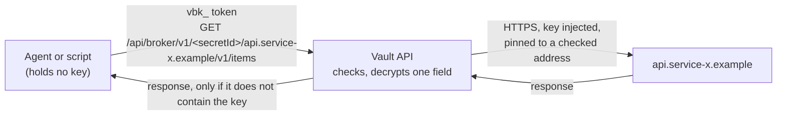

# Runbook: credential broker

Operator and owner procedures for the credential broker: let an agent (a coding assistant in a cloud sandbox, a script, an SDK) **use** a key stored in Vault without ever seeing it. The agent calls Vault, Vault adds the key and forwards the request to an upstream host you allowed, and returns the upstream's response. Design and reasoning: [ADR-0006](../decisions/0006-credential-broker.md). Threat model and controls: [SECURITY-ARCHITECTURE.md, credential broker](../SECURITY-ARCHITECTURE.md#credential-broker-adr-0006-246). Endpoint reference: [API.md, Credential broker](../API.md#credential-broker). Commands: [apps/cli/README.md](../../apps/cli/README.md#broker--credential-broker).

Examples use invented names: `https://vault.example.test` (your Vault), `api.service-x.example` (the service whose key you store), `api-key-example` (the secret's name), `person-a@example.test`. Token and key values are never real.

## What it is



| Fact | Detail |
|---|---|
| What the agent holds | A `vbk_` broker token (or a personal access token). Neither can read a secret: a `vbk_` token is accepted on `/api/broker/v1/*` and nowhere else |
| What Vault holds | The key, encrypted at rest as for every secret. It is decrypted only for the one forward, after every other check passed, and exists only in that one outbound request |
| What the agent sees | The upstream's response (status, filtered headers, body). Never the key: a response that contains it is withheld (`502 BROKER_KEY_ECHO`) |
| Where it applies | An API that takes the key in a header (default `Authorization: Bearer <key>`) or a query parameter. Supported secret types: API Key, Token, Service Key, and custom types with a sensitive field. Cards, passports, ID documents and logins cannot be used |
| Off by default | Two administrator switches, then a per-secret opt-in by the owner, then a token |

## Two switches (administrator)

Both are off by default. While either is off, every forward answers `403 BROKER_DISABLED` before anything is looked up.

| Switch | Where | Permission |
|---|---|---|
| Agent access (the deployment kill switch) | Admin settings, `Agents`, `Agent access` (`/admin/settings/agent-access`), "Allow agent access" | `system_settings:write` |
| Credential broker | The same page, block "Credential broker", "Allow the credential broker" | `system_settings:write` |

1. Open `/admin/settings/agent-access` and switch Agent access on (see [agent-access runbook](agent-access.md#two-switches-both-off-by-default)).
2. In the "Credential broker" block switch the broker on, review the limits ([below](#limits-and-settings)) and save.
3. Make sure the API host may open outbound HTTPS to the services owners will allow (firewall, network policy). Vault becomes an egress point: see [Security notes](#security-notes).

No deploy or restart is needed to switch it on or off. Switching it off stops every forward at once.

## Opt a secret in (the owner)

Only you can opt in your own secret (`secrets:write`, owner only: an administrator's `secrets:write_any` does not open someone else's). It needs a browser session or a personal access token; an agent token is refused (`403`), so an agent can never open a secret for itself.

**Web app.** Open the secret, turn on "Allow use through the broker", and in the dialog:

1. Add one or more **origins**: exact HTTPS origins, `https://host[:port]` (1 to 20).
2. Choose **how the key is added**: a header (name and prefix) or a query parameter (name). The default is `Authorization: Bearer <key>`.
3. If the type has several sensitive fields, choose the **field** that holds the key.
4. Confirm. The panel then shows each origin's base URL with a copy button; the secret list shows a "Broker" chip.

**CLI.**

```bash
vault secrets broker api-key-example on --origin https://api.service-x.example
vault secrets broker api-key-example on --origin https://api.service-x.example --header X-Api-Key --prefix none
vault secrets broker api-key-example on --origin https://api.service-x.example --query api_key --field key
vault secrets broker api-key-example off
vault broker url api-key-example        # prints the base URL for each origin
```

Rules:

| Rule | Detail |
|---|---|
| Origins | `https://host[:port]`, lower case. No path, query, fragment or user name. No wildcards: a subdomain is another origin. Default port 443 (`:443` is dropped). Refused (`422 BROKER_ORIGIN_INVALID`): another scheme, `localhost` and any `*.localhost`, `*.local` or `*.internal` name, a host with no dot, a trailing dot, an IP address in a private, loopback, link-local, metadata or otherwise reserved range. A public IP address is allowed |
| Header injection | `name` is 1 to 64 letters, digits or hyphens. `prefix` is none, `Bearer`, `Token`, `Basic`, `Bot` or `ApiKey`. With `Basic` the stored key must be `user:password`; Vault sends `Basic base64(user:password)`. A name of `host`, `cookie`, `set-cookie`, `content-length`, `transfer-encoding`, `connection`, `upgrade`, `forwarded`, `x-real-ip`, or starting with `proxy-`, `x-forwarded-` or `x-vault-`, is refused |
| Query injection | `name` is 1 to 64 letters, digits, dots, hyphens or underscores. A query parameter of that name sent by the caller is replaced |
| Field | The sensitive string field to inject. Needed only when the type has more than one (`422 BROKER_FIELD_INVALID` otherwise) |
| Re-saving | Origins, injection and field you do not send keep their stored values; turning it off is always allowed and keeps them for next time |
| Audit | `secret.broker_access.update` with from/to, the origins and the injection kind and name. Never a value |

## Create a broker token (the owner)

A broker token is what an agent presents. It can use your broker-enabled keys and can never read them.

**Web app.** Open `/settings/broker-tokens` ("Broker tokens", no permission needed beyond being signed in), create a token, give it a name, an expiry and, optionally, the secrets it may use. **The token is shown once**; copy it now. Only its SHA-256 hash is stored.

**CLI.**

```bash
vault broker token create --name agent-ci --expires 90 --secret api-key-example
vault broker token list
vault broker token revoke <id> --yes
```

| Setting | Rule |
|---|---|
| Name | 1 to 100 characters, for you to recognize it |
| Expiry | Required: 1 to 3650 days, default 90. There is no token that never expires |
| Restriction | Optional list of up to 100 of **your own secrets that have the broker on** (`422 BROKER_TOKEN_SECRET_INVALID` otherwise). Empty or absent means every broker-enabled secret you own, including ones you opt in later |
| Shape | `vbk_` plus 40 letters and digits. The list shows only the first 12 characters |
| Where it works | Only `/api/broker/v1/*`. On every other route it is a `401`. It cannot create, list or revoke tokens |

Prefer one token per agent or environment, restricted to the secrets that agent needs, with a short expiry.

## Set up Claude Code on the web (cloud)

Goal: code running in the cloud sandbox calls `api.service-x.example` with your key, and neither the key nor the `vbk_` token is ever in the sandbox.

1. **Enable and opt in.** Switch the broker on ([Two switches](#two-switches-administrator)), opt the secret in with origin `https://api.service-x.example`, and note its id (`vault secrets get api-key-example`, or the base URL the panel shows).
2. **Create a token** restricted to that secret ([above](#create-a-broker-token-the-owner)).
3. **Save the token as a network secret for the Vault host.** In the cloud environment's settings add a network secret (credential) with:

   | Field | Value |
   |---|---|
   | Host | Your Vault host, `vault.example.test` (the host only: no scheme, no path) |
   | Header | `Authorization` |
   | Prefix | `Bearer` |
   | Value | The `vbk_...` token |

   The environment's network proxy adds `Authorization: Bearer vbk_...` to HTTPS requests the sandbox makes to that host, and saving the secret also allows the host through the environment's network rules. The sandbox's own code and environment variables never contain the token. Do not paste the token into the chat or into a file in the repository. Steps and wording of the settings page change over time: see the cloud environment's secrets documentation.
4. **Point the code at the base URL**, `https://vault.example.test/api/broker/v1/<secretId>/api.service-x.example`, and send **no** key of your own. The path after the host is the upstream's path.

curl:

```bash
BASE=https://vault.example.test/api/broker/v1/<secretId>/api.service-x.example
curl -sS "$BASE/v1/items?limit=10"
curl -sS -X POST "$BASE/v1/items" -H 'Content-Type: application/json' -d '{"name":"item-a"}'
```

Node `fetch`:

```js
const base = 'https://vault.example.test/api/broker/v1/<secretId>/api.service-x.example';

const res = await fetch(`${base}/v1/items?limit=10`);
// Vault's own refusals have a JSON body with a "code" and no x-vault-broker header.
if (res.headers.get('x-vault-broker') !== '1') {
  throw new Error(`Vault refused: ${JSON.stringify(await res.json())}`);
}
console.log(res.status, await res.json()); // the upstream's status and body
```

An SDK with a configurable base URL (the name of the option varies by SDK; use a placeholder key because most SDKs insist on one):

```js
const client = new ServiceXClient({
  baseURL: 'https://vault.example.test/api/broker/v1/<secretId>/api.service-x.example',
  apiKey: 'unused', // the SDK sends it as its own header; Vault drops it and injects the real key
});
```

Why this works and what to know:

- The caller's `Authorization`, `Cookie`, `Host`, `Proxy-*`, `Forwarded`, `X-Forwarded-*`, `X-Real-IP` and `X-Vault-*` headers are **removed** before forwarding, so a placeholder key an SDK sends is dropped and Vault injects the real one. If the secret is injected in a different header (for example `X-Api-Key`), an SDK that sends its own `X-Api-Key` has it replaced, not duplicated.
- The proxy supplies the `vbk_` token on requests to the Vault host only. A `vbk_` token authenticates nowhere but `/api/broker/v1/*`, so a stolen token cannot read a secret or reach any other API.
- Rotating the key is done in Vault ([below](#rotate-the-key)); the sandbox needs no change.
- The agent still sees what the service returns. The broker protects the key, not the data behind it.

## Use from a script or CI

A script can use a `vbk_` token or a personal access token (`pat_`). Prefer `vbk_`: a PAT carries your full authority, and a broker token only the broker. Store the token in the runner's secret store, never in the repository.

```bash
export VAULT_BROKER_TOKEN=vbk_...   # from the CI secret store; never echo it
curl -sS -H "Authorization: Bearer $VAULT_BROKER_TOKEN" \
  https://vault.example.test/api/broker/v1/<secretId>/api.service-x.example/v1/items
```

An `oat_` token (an OAuth app) and a browser session are refused (`403 BROKER_CREDENTIAL_REFUSED`).

## Rotate the key

The key lives only in Vault. Edit the secret (a new version) or rotate the key with the service and update it in Vault: the next forward injects the new current version. Nothing in a sandbox, script or token changes.

## Revoke a token, or switch it off

| To stop | Do | Effect |
|---|---|---|
| One agent or environment | `/settings/broker-tokens`, revoke, or `vault broker token revoke <id> --yes` | The next call with that token is `401` |
| One secret | Turn "Allow use through the broker" off (web) or `vault secrets broker <id> off` | Every token now gets the same `404` for it |
| One origin | Edit the secret's origins | Calls to it are `403 BROKER_ORIGIN_MISMATCH` |
| Everything | An administrator switches the broker (or Agent access) off | `403 BROKER_DISABLED` for all |

No deploy or restart. If a token may have leaked, revoke it and read Agent activity for what it did; then rotate the key if it may have been misused.

## Read Agent activity

Open `/settings/agent-activity`. Each forward appears as "Used through the broker" with the secret, the upstream origin, the method, the upstream status and the result (allowed or refused with the reason). Filter by action `broker_forward`. The underlying audit row is `broker.forward`: secret id, token id and kind (`broker` or `pat`), origin, method, the path **without** the query string, status, request and response byte counts, duration and outcome. Never the key, a body, the query or a header. Every call that identifies a user is audited, allowed or refused, and a successful call is audited before its response is returned: if the row cannot be written the call fails.

Not audited: a refused credential kind (`oat_`, a session, an unknown or expired `vbk_` token), because no user is identified.

## Limits and settings

Administrator, `agentAccess.broker` on `/admin/settings/agent-access`:

| Setting | Default | Range | Effect |
|---|---|---|---|
| `enabled` | off | | The broker switch ([above](#two-switches-administrator)) |
| `forwardsPerMinute` | 60 | 1 to 10000 | Forwards per minute, per token and user. Over it: `429 RATE_LIMITED` with `Retry-After`. Counted before any secret is looked up. In process memory (one API instance) |
| `maxRequestBytes` | 10 MiB | 1 byte to 100 MiB | Larger request bodies are refused with `413 BROKER_REQUEST_TOO_LARGE` (by `Content-Length` before sending, and by a counter while streaming) |
| `maxResponseBytes` | 25 MiB | 1 byte to 100 MiB | A larger response (or one that decompresses past it) is withheld: `502 BROKER_RESPONSE_TOO_LARGE`. The response is buffered in memory so it can be scanned |
| `timeoutMs` | 30000 | 1000 to 120000 | The whole exchange. Over it: `504 BROKER_UPSTREAM_TIMEOUT` |

Fixed behaviour, not settings:

| Behaviour | Detail |
|---|---|
| Methods | `GET`, `POST`, `PUT`, `PATCH`, `DELETE`, `HEAD`, `OPTIONS`; any other is `405` |
| Redirects | Never followed. A `3xx` is returned as is, with `Location`; the caller decides |
| Compression | Vault asks the upstream for no compression (`Accept-Encoding: identity`). If it compresses anyway (gzip, deflate, br) Vault decodes it up to the response cap, scans, and returns the **decoded** body without `Content-Encoding`. An unknown encoding is `502 BROKER_UPSTREAM_ERROR` |
| Request body | Streamed through a byte counter, never buffered whole. `Content-Length` is passed through; a chunked body stays chunked. `Expect` is dropped |
| Upstream `Host` | The origin's host (and port when not 443), not the caller's |
| Response headers | `Set-Cookie`, hop-by-hop headers, `Content-Length` and `Content-Encoding` are dropped; `X-Vault-Broker: 1` is added. The body is not wrapped in `{ data }` |
| TLS | HTTPS only, TLS 1.2 or later, certificate and host name always verified. Connection pinned to the address Vault validated |
| `last used` | A token's last use is recorded at most once a minute |

## Troubleshooting

A refusal by Vault is a JSON error (`{ statusCode, code, message, ... }`) with **no** `X-Vault-Broker` header. A response from the upstream, whatever its status, carries `X-Vault-Broker: 1`: an upstream `401` or `404` is the service's answer, not Vault's.

| Status and code | Cause | Fix |
|---|---|---|
| `401` (no `code` of the broker) | No `Authorization` header, or a `vbk_` token that is unknown, revoked, expired or whose owner is inactive (one answer for all), or an invalid `pat_` | Check the token is attached to requests for the Vault host (network secret host and header), not revoked or expired; create a new token |
| `403 BROKER_DISABLED` | Agent access or the credential broker is switched off | Administrator switches both on ([Two switches](#two-switches-administrator)) |
| `403 BROKER_CREDENTIAL_REFUSED` | The credential is an `oat_` token, a browser session or another kind; only `vbk_` and `pat_` are accepted | Use a broker token (or a PAT for a script) |
| `403 BROKER_ORIGIN_MISMATCH` | `https://<host>` in the URL is not exactly one of the secret's allowed origins (a subdomain, another port, a typo), or the host segment is not a plain `host[:port]` | Use an allowed origin in the URL, or add the origin to the secret |
| `403 BROKER_DESTINATION_BLOCKED` | The host resolves to a private, loopback, link-local, metadata or otherwise reserved address (any one of its addresses). Nothing was sent | Expected for internal services. A public host that resolves to such an address (misconfigured DNS, split-horizon) must be fixed in DNS |
| `404` | One answer for: the secret does not exist, is not yours, has the broker off, is a type the broker cannot use, or is outside this token's restriction | Check the id, that you own it, that "Allow use through the broker" is on, and the token's restriction |
| `405` | A method the broker does not forward | Use `GET`, `POST`, `PUT`, `PATCH`, `DELETE`, `HEAD` or `OPTIONS` |
| `413 BROKER_REQUEST_TOO_LARGE` | The body is above `maxRequestBytes` | Send less, or an administrator raises the limit |
| `422 BROKER_KEY_MISSING` | The secret has no value in the injected field, or the value contains line breaks or a null character | Put the key in the field the broker uses (check the field in the opt-in dialog) |
| `422 BROKER_UNSUPPORTED_TYPE` | (Opt-in) the type cannot be used: Card, Passport, ID Document, Credential, Note, or a custom type with no sensitive field | Store the key as an API Key, Token or Service Key secret |
| `422 BROKER_ORIGINS_REQUIRED` | (Opt-in) enabling without an origin | Add at least one `https://host[:port]` |
| `422 BROKER_ORIGIN_INVALID` | (Opt-in) an origin is not an exact public HTTPS origin, or more than 20 were sent | Fix the origin ([rules](#opt-a-secret-in-the-owner)) |
| `422 BROKER_INJECTION_INVALID` | (Opt-in) the injection stored on the secret no longer validates | Send a new `injection` in the same request |
| `422 BROKER_FIELD_INVALID` | (Opt-in) `field` is not a sensitive field of the type, or the type has several and none was named | Name one of the sensitive fields |
| `422 BROKER_TOKEN_SECRET_INVALID` | (Token create) a restriction names a secret that is not your own with the broker on | Opt the secret in first, or drop it from the restriction |
| `429 RATE_LIMITED` | More than `forwardsPerMinute` calls in a minute for this token | Wait for `Retry-After`; an administrator raises the limit if legitimate |
| `502 BROKER_UPSTREAM_ERROR` | The connection failed (DNS, refused, TLS verification failed, reset), the upstream's compression could not be decoded, or the response used an unknown encoding. No detail is returned on purpose | Check the origin is reachable from the API host and presents a valid public certificate. Look at the API log (it carries no address or key) |
| `502 BROKER_RESPONSE_TOO_LARGE` | The response (or its decompressed size) is above `maxResponseBytes` | Ask for less (pagination, a range), or raise the limit. Large downloads and streams are not supported |
| `502 BROKER_KEY_ECHO` | The upstream response contained the key (in the body or any header, in a recognized encoding) and was withheld whole | The service echoes credentials (some debug or "whoami" endpoints do). Use another endpoint. If it happens on ordinary calls the upstream is returning your key in its responses: consider rotating it |
| `504 BROKER_UPSTREAM_TIMEOUT` | No answer within `timeoutMs` (including DNS) | Retry; an administrator raises the timeout for slow APIs |

Other symptoms:

| Symptom | Cause | Fix |
|---|---|---|
| The upstream answers `401` with `X-Vault-Broker: 1` | The key is wrong, expired, or injected in the wrong place (header name, prefix, query name) | Check the secret's value and the injection against the service's documentation; `Basic` needs the key stored as `user:password` |
| The upstream says the request was redirected or the body is missing after a redirect | Redirects are not followed | Call the final URL |
| The sandbox cannot reach the Vault host | The host is not allowed in the cloud environment's network rules | Saving the network secret allows the host; otherwise add it |
| The agent says "invalid API key" from its SDK | The SDK validates the key format locally | Give it a placeholder in the shape it expects; Vault replaces it |

## Security notes

What the broker protects against:

- **The agent reading the key.** No route returns it, a `vbk_` token cannot reach one, and a response containing the key (as is, base64, base64url, percent-encoded, or the injected header value) is withheld, fail closed.
- **Leaking the key to another host.** Origins are exact; redirects are never followed; the connection is pinned to a validated address.
- **Reaching internal services (SSRF).** Every address the host resolves to must be public, checked after resolution, once, and the connection is pinned to it so a second lookup cannot redirect it.
- **Token theft.** Only a hash is stored; tokens expire, can be restricted to chosen secrets and revoked, are confined to the broker and rate-limited, and every call is audited.

What it does not protect against:

- **The agent sees API responses.** Whatever the service returns enters the agent's context.
- **Prompt injection can use your key.** A model steered by a hostile page can send any request your key permits to an allowed origin, within the rate limit, until you notice. Allow narrow origins, opt in scoped keys that are cheap to rotate, restrict tokens to the secrets they need, and watch Agent activity.
- **Transformed echoes.** An upstream that returns the key hashed, split or otherwise transformed is not detected; the origin allowlist is what limits who could do that.
- **The operator accepts egress.** The API host makes outbound HTTPS calls to every origin an owner allows. Allow it deliberately in network policy, and keep the broker off if you do not want that.
- **Buffering.** Responses are held in memory up to `maxResponseBytes` so they can be scanned. Large or streaming responses are not supported.

Related: [agent access runbook](agent-access.md) (logins and MCP, a different surface), [agent credential API](../agent-credential-api.md) (the REST API for agent runtimes that fill a login), [ADR-0005](../decisions/0005-assistant-reveal.md) (revealing a value to an assistant, the alternative this replaces for "use, not know").
